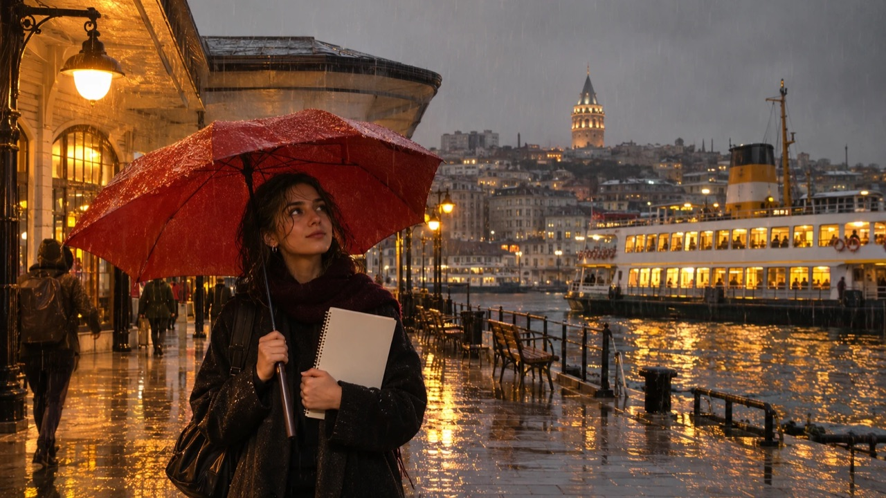
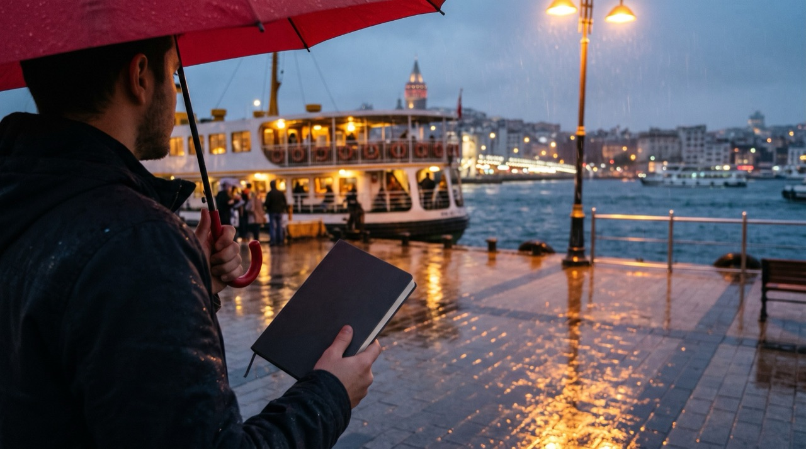
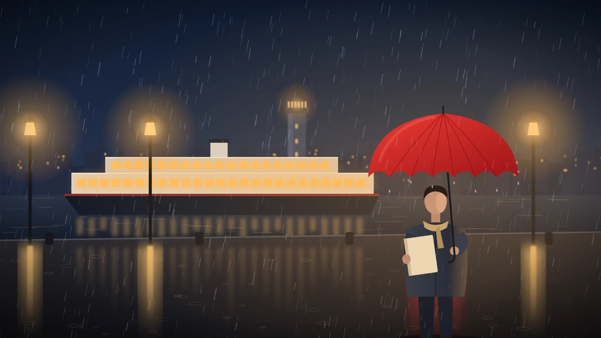
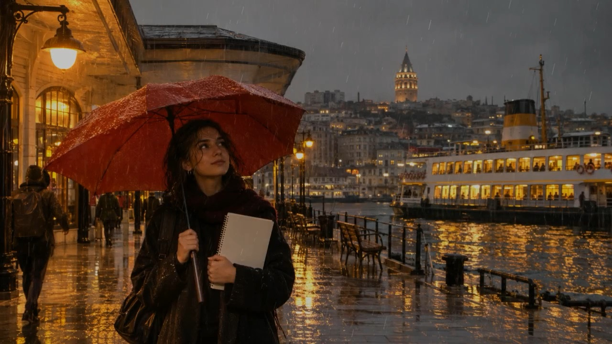
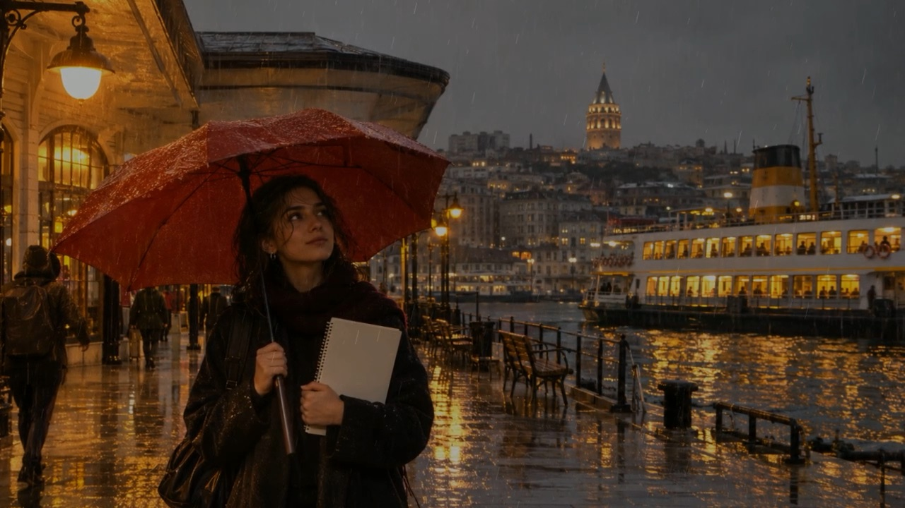
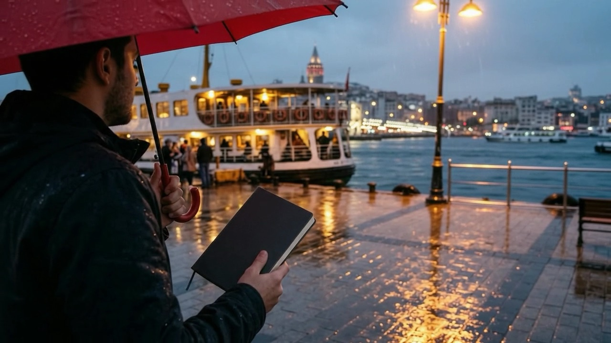
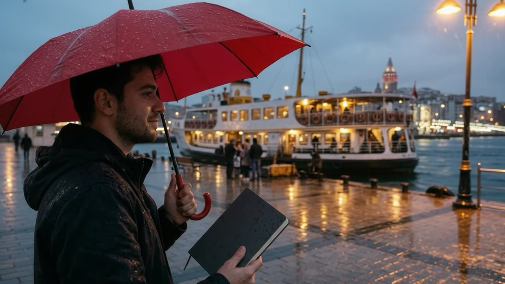

# Görsel ve Video Benchmark

Bu hafta görsel kısmını yaptım: 3 fotoğraf modeli ve 2 video modeli. Metin modellerini yapmadım.

## Kullandığım modeller

| Araç | Model |
|---|---|
| ChatGPT | GPT Sol |
| Gemini | Nano Banana |
| Claude | Opus 5.5 |

Fotoğrafları ve videoları aynı modellerle ürettim. Video için sadece ChatGPT (GPT Sol) ve Gemini (Nano Banana) ile denedim, Claude video üretemiyor.

## Prompt (3 modele de aynen verildi, yeni sohbet, ilk sonuç)

> A rainy evening at a ferry pier in Istanbul. In the foreground, a university student holds a red umbrella and a plain notebook with a blank cover, no text anywhere. Behind them, a ferry with warm lit windows and the Galata Tower on the skyline. Realistic photograph, warm street lamp light, wet reflections on the ground, 16:9.

### Video prompt'u (fotoğraf prompt'unun devamı)

> Same scene. The student closes the red umbrella and walks toward the ferry while the ferry slowly docks at the pier. Light rain, steady camera, realistic motion.

## Puanlama ölçütü (önceden yazdım, her biri 1-5)

- **Sadakat:** kırmızı şemsiye, vapur, Galata Kulesi, yağmur ve ıslak zemin yansıması var mı?
- **Yazı:** prompt'ta "no text anywhere" dedim, defterin ya da başka bir yerin üstünde yazı çıkmış mı?
- **Yüz/detay:** yüz ve eller doğal mı, görüntü gerçekçi bir fotoğraf gibi mi?
- **Maliyet:** ücretli mi, ücretsiz mi? Üçünü de ücretli abonelikle kullandım.
- **Hareket (video):** istenen hareket gerçekten oluyor mu, yoksa görüntü duruyor mu?
- **Tutarlılık (video):** kişi, şemsiye ve vapur karelerde aynı kalıyor mu?

Aynı oran: üç modelde de 16:9 çıktı.

## Sonuçlar

### Fotoğraf

| Model | Sadakat | Yazı | Yüz/detay | Maliyet | Toplam /15 |
|---|---|---|---|---|---|
| Gemini (Nano Banana) | 5 | 5 | 5 | Ücretli | **15** |
| ChatGPT (GPT Sol) | 4 | 5 | 4 | Ücretli | **13** |
| Claude (Opus 5.5) | 2 | 5 | 2 | Ücretli | **9** |

### Video

| Model | Süre | Hareket | Tutarlılık | Maliyet | Toplam /10 |
|---|---|---|---|---|---|
| Gemini (Nano Banana) | 10 sn | 3 | 4 | Ücretli | **7** |
| ChatGPT (GPT Sol) | 9 sn | 1 | 5 | Ücretli | **6** |

İkisi de 1280x720 (16:9) çıktı. Claude video üretemediği için sadece iki modelle denedim.

### Fotoğraflar

**ChatGPT** 

**Gemini** 

**Claude** 

### Videolar

- ChatGPT: [videolar/chatgpt.mp4](videolar/chatgpt.mp4)
- Gemini: [videolar/gemini.mp4](videolar/gemini.mp4)

| | Başı | Sonu |
|---|---|---|
| ChatGPT |  |  |
| Gemini |  |  |

## Yorum

Üç modele de aynı prompt'u verdim. Bence en iyisi Gemini oldu, çünkü gerçekten çekilmiş bir fotoğraf gibiydi: yağmurdaki ışıklar, ıslak zemin ve kişinin duruşu daha doğaldı, prompt'taki "gerçekçi fotoğraf" isteğine en yakın olan oydu. Küçük eksikleri vardı, Galata Kulesi küçük kaldı ve şemsiye kadrajdan taştı. ChatGPT de çok iyiydi, kırmızı şemsiye, vapur, Galata Kulesi ve yağmur hepsi vardı, ama bana fazla parlak ve sinematik, yani biraz yapay göründü. Claude'un çıktısı en kötüsüydü, çünkü fotoğraf yerine düz bir çizim yaptı, kule Galata'ya değil de fenere benziyordu ve kişinin yüzü yoktu. Üçünde de defterin üstüne yazı koymadılar, bu kısmı hepsi doğru yaptı. Beni şaşırtan şey Claude'un bir görsel modeli olmaması, çizimi muhtemelen kodla yaptı. O yüzden fotoğraf testinde adil bir karşılaştırma olmadı.

Videoda ChatGPT en kötüsüydü. 9 saniyede neredeyse hiçbir şey olmadı, ilk ve son kareler aynı gibi, sadece yağmur yağıyor ve kamera azıcık yaklaşıyor. Kız ve vapur tutarlıydı ama hareket yoktu, yani fotoğrafa biraz yağmur eklenmiş gibi. Gemini ortalama bir sonuç verdi: kamera döndü, adam yana dönüp yüzü göründü, defter açıldı, ama vapurun iskeleye yanaşması gibi büyük bir hareket olmadı.
